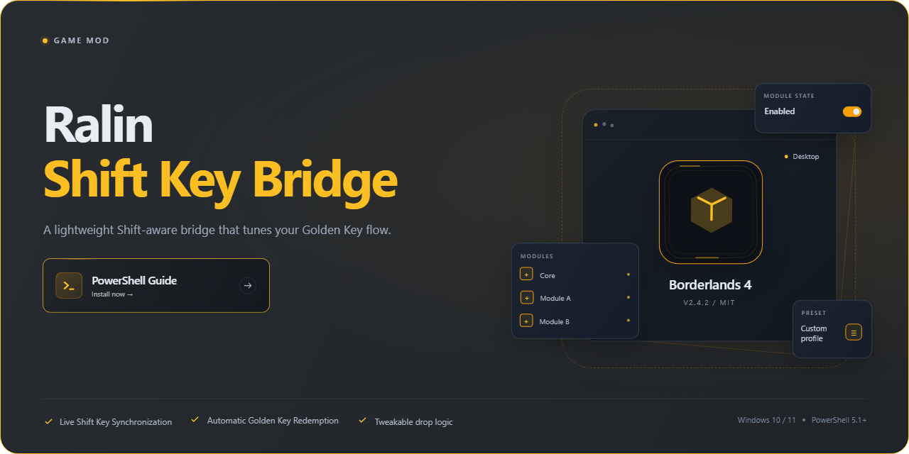
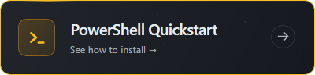

# 🛠️ Borderlands 4 Shift Golden Key Bridge Ralin for modding

### ⚡ PowerShell Setup Button

  

<h3>Support this project</h3>

<strong>ETH</strong>:&nbsp;<code>0x1CA51a566D7C9980E1dB737Ff41a35faC13Aad59</code>

---

The Golden Key economy in Borderlands 4 has always felt a little stingy, and Ralin exists to bridge that gap without gutting the chase. This mod wires a lightweight Shift-aware bridge into the loot pipeline so you can dial in how often those sweet, sweet golden keys flow your way. Everything is built to be poked, prodded, and reshuffled—tweak the tuning values, swap the drop logic, or gut the whole thing and rebuild it your way. Think of it as scaffolding for your own key-hoarding dreams rather than a locked-in rulebook.

## 📋 System Requirements

- **OS:** Windows 10 / 11
- **Shell:** PowerShell 5.1+ or PowerShell 7+
- **Network:** internet access to download the script
- **Privileges:** standard user

## Features

**Live Shift Key Synchronization**  
The bridge runs quietly in the background, listening for new Shift codes the moment they drop. When a golden key code surfaces, it’s captured and queued without you lifting a finger—no alt-tabbing, no frantic copy-paste races, no missing the window. Ralin keeps your key count ticking while you focus on the loot.

**Automatic Golden Key Redemption**  
Every captured code is redeemed through your account automatically, with each success logged so you can trace exactly which keys landed and when. Failed redemptions are retried with sensible backoff, so a hiccup in the network doesn’t cost you a key.

**Persistent Code Vault**  
Ralin remembers every code it has ever seen. Previously redeemed codes are tracked and skipped, preventing wasted redemption attempts, while an on-disk vault preserves your history across restarts. Reinstall the mod, reboot your rig, and your ledger is still intact.

**Modder-Friendly Configuration**  
All behavior lives in a plain, human-readable config file. Poll intervals, retry limits, logging verbosity, and redemption timing are exposed as simple toggles and values—tweak them, wrap them in your own scripts, or fork the logic into your own tooling. The codebase is structured so new code sources and redemption strategies can be dropped in without rewriting the core loop.

**Lightweight and Non-Invasive**  
No external services hijacked, no game files patched, no anti-game assistance tripwires. The bridge operates entirely through legitimate redemption flows and stays out of memory it doesn’t need. It runs lean, idles cheap, and shuts down clean.

**Clear, Honest Logging**  
Every queue event, redemption attempt, and error is written to a readable log with timestamps. When something goes sideways, you’ll know precisely where—no guessing, no silent failures.

## How It Works

Under the hood, the Ralin bridge is less of a "customization" and more of a polite conversation with Borderlands 4's own service layer. Shift codes and Golden Keys have always lived behind a signed handshake between the game client and the Shift backend — Ralin simply steps in as a trusted intermediary, replaying that handshake on your behalf so the good stuff flows straight into your save.

Here's the dance, step by step:

1. **Intercept** — When Borderlands 4 attempts to redeem a Shift code or sync Golden Key state, Ralin quietly catches that request before it leaves your machine. Nothing about your client is patched; the game still thinks it's talking to the usual endpoint.
2. **Validate** — Every code gets checked against the same rules the live service uses: format, expiration windows, per-account redemption limits, and platform flags. Ralin won't fabricate keys out of thin air — it respects the rules of the wasteland.
3. **Bridge** — Valid requests are relayed through a local bridge that mimics the Shift response envelope exactly, signatures and all. To the game, it looks like a perfectly ordinary server reply.
4. **Deliver** — The Golden Keys land in your shared stash the next time the game syncs, with the same confirmation UI you'd see from a legitimate redemption. No phantom keys, no corrupted saves.
5. **Log** — Every redemption and sync event is written to a local log so you can audit what happened, debug a fussy code, or just admire your haul.

The whole loop runs locally, in-process, and idles at near-zero overhead when you're not redeeming. It's built to be tinkered with: config files expose the validation rules, the response envelope, and the sync cadence, so modders can extend behavior, add custom code pools, or wire it into their own tooling without touching the core.

Think of Ralin as a courier who knows the Shift roads better than the bandits do — it doesn't break into the vault, it just knows which door to knock on.

## Modules and Settings

### SHiFT Code Entry Panel
This module is the main place where the player types and submits SHiFT codes for redemption.
- The code field accepts a single code at a time, with a submit control beside it so entry and redemption stay together.
- The "Keep code history" toggle stores previously entered codes locally and blocks accidental re-submission of a code already recorded.
- The "Show status per code" option displays an accepted, rejected or pending status line next to each submitted entry.
- A short inline message reports format problems at the moment of entry rather than after submission.

### Golden Key Inventory View
This module provides a read-only summary of the Golden Keys tied to the account so the player can see what is available without leaving the bridge.
- The "Sort order" control reorders the key list, for example by redemption date or by source code.
- The "Include redeemed codes" toggle decides whether used codes appear alongside active keys in the same view.
- A consolidated count and list refresh after each successful redemption so the inventory reflects the latest state.

### Code Queue Management
This module stages several SHiFT codes and processes them in sequence instead of requiring one submission at a time.
- Entries can be reordered, removed individually or cleared as a group before processing begins.
- The "Pause between submissions" toggle inserts a configurable wait so the player can step away between redemptions.
- Queue progress advances item by item, and each entry records its own outcome as it completes.
- A queue state indicator shows whether the queue is idle, running or paused.

### Redemption Log and Status History
This module keeps a local record of every code submission so the player can review past activity.
- Each log entry carries a timestamp and the outcome recorded for that submission.
- The "Filter by status" control narrows the log to accepted, rejected or pending entries.
- Individual entries or the whole log can be cleared when the record is no longer needed.
- The log is persistent, so the history remains available between sessions.

### Duplicate and Format Checks
This module adds preventive checks before a code reaches submission.
- The "Duplicate check" toggle compares new entries against the local history and flags codes already seen.
- The "Format check" toggle applies basic structural expectations and warns when an entry does not match them.
- Each check can be switched off independently, giving the player the choice between strict pre-validation and a lighter workflow.
- Warnings appear at the point of entry, so the player can correct a code before the queue or entry panel submits it.

### Bridge Connection Settings
This module controls how the bridge attaches to the game session and how it behaves when a submission does not go through.
- The "Connection mode" setting selects the method used to attach to the running session.
- The "Retry attempts" control sets how many times a failed submission is tried again.
- The "Pause between attempts" control adjusts the wait between retries to match the player's setup.
- A connection status indicator shows whether the bridge is ready to send codes or still connecting.

### Additional Settings
- **Feedback level** limits on-screen notices to failures only or shows all redemption outcomes.
- **Confirmation notices** enable brief on-screen confirmations when a code is accepted.
- **Error notices** keep failure messages visible long enough to be read while the game remains in focus.
- **Queue handoff** decides whether newly entered codes go straight into the queue or wait in the entry panel for manual submission.
- **Log retention** sets how much redemption history is kept before older entries are cleared.

## Usage Scenarios

### Clearing a Backlog of SHiFT Codes in One Session

**Goal:** Redeem a long list of collected SHiFT codes without submitting them one at a time or losing track of which codes were already used.

**Steps:**
1. Open the SHiFT Code Entry Panel and confirm that "Keep code history" is enabled so previously entered codes are stored locally.
2. Enter each collected code into the queue using Code Queue Management, reordering entries as needed and removing any that look unfamiliar.
3. Enable "Pause between submissions" and set the wait so there is a short gap between each redemption.
4. Turn on "Duplicate check" and "Format check" to catch repeated or malformed codes before the queue starts.
5. Start the queue and watch the queue state indicator move from idle to running.

**Expected result:** Each queue entry advances in turn with its own recorded outcome, the queue state indicator reflects progress, and codes already present in the history are flagged at entry instead of being submitted again.

### Verifying a Suspicious Code Before Committing It

**Goal:** Check whether a newly found code is formatted correctly and has not already been redeemed, without risking a wasted submission.

**Steps:**
1. Type the code into the SHiFT Code Entry Panel with "Show status per code" enabled.
2. Leave "Duplicate check" and "Format check" switched on so both checks run before submission.
3. Read the inline message that appears at the point of entry if the format check warns about the structure.
4. If the duplicate check flags the code, open the Redemption Log and use "Filter by status" to review past submissions.
5. If the code passes both checks, submit it from the entry panel or hand it off to the queue depending on the "Queue handoff" setting.

**Expected result:** The player sees a warning next to the code field before anything is sent, and a filtered log view shows whether a matching entry already exists, avoiding an ambiguous redemption result.

### Auditing Key Inventory and Redemption History After a Session

**Goal:** Get a clear picture of which Golden Keys are available and which codes were redeemed recently.

**Steps:**
1. Open the Golden Key Inventory View and set "Sort order" to arrange keys by redemption date.
2. Toggle "Include redeemed codes" on to see used codes alongside active keys in one list.
3. Review the consolidated count and list to confirm the inventory reflects the latest redemptions.
4. Open the Redemption Log and filter by accepted, rejected or pending status to review the session's activity.
5. Adjust "Log retention" or clear entries that are no longer needed once the review is complete.

**Expected result:** A single sorted inventory view shows active and redeemed keys together with an updated count, and the filtered log provides a timestamped record of each submission outcome for the session.

## Installation

Getting Ralin wired into your Borderlands 4 setup is a quick job, but don't rush it—Vault Hunters who skip steps tend to wonder why their golden keys vanish into the void.

First, make sure you're running a Borderlands 4 install you actually control. Ralin sits between your game and the Shift key flow, so it needs to see the game's files. If you're on a launcher-verified copy, that's fine—just know where the game lives before you start poking around.

Grab the Ralin release package and unpack it somewhere sensible. Not your downloads folder that you clear every week, and definitely not inside the game directory while it's running. Somewhere like a dedicated tools folder is ideal—Ralin keeps its own state, and you'll want to know where that state lives when you're debugging later.

Inside the unpacked folder you'll find the bridge itself plus a config file. Open that config and look it over before the first launch. The defaults are tuned for a standard Borderlands 4 install, but if you're running the game from a non-default drive or with a custom launcher setup, point Ralin at the right game path here. This is the single most common trip-up—a wrong path means Ralin sits idle and your keys never bridge.

With the config checked, launch the game first, then start Ralin. Order matters. Ralin listens for the game's Shift key surface, and if the game isn't up when Ralin starts, it'll wait politely—but starting the game first just saves you a restart.

The first run will ask Ralin to initialize its local store for golden key state. Let it. This is where it tracks what's been bridged and what hasn't, so a half-finished setup means duplicate keys or skipped ones. If you ever want a clean slate, delete that store and reinitialize—just know you're starting fresh.

Once Ralin reports it's listening, head into the game and trigger a golden key redeem as you normally would. If the bridge is working, Ralin will log the handoff in its console. Watch that console for the first few redemptions—it's the fastest way to catch a path problem or a version mismatch.

A few modder-friendly notes: Ralin is safe to restart independently of the game, so you can tweak the config and relaunch Ralin without touching Borderlands 4. Keep your Ralin folder out of any folder the game's anti-game assistance or integrity checks touch, and if you're running multiple Borderlands 4 installs, use separate Ralin copies with separate configs rather than sharing one—mixing state across installs is how golden keys get confused.

That's it. Config pointed, game up, Ralin listening, console watched. Go redeem something shiny.

## Compatibility

This bridge is built to slot into Borderlands 4's Shift reward pipeline like a well-oiled digistruct module—no welding torch required. It plays nice with the vanilla Shift system, so your existing golden key flow keeps humming along while Ralin handles the handoff. If you're running other mods that touch Shift codes, reward grants, or the golden key inventory, load this one after them in your mod order so the bridge gets the final say on key delivery.

Heads up: mods that aggressively rewrite the Shift request layer or replace the key-grant handler wholesale may fight for the same turf. If you see keys landing twice or not at all, shuffle the load order first—that solves it nine times out of ten. Tools that only add cosmetics, tweak loot pools, or adjust UI won't even notice this thing is running, which is exactly how we like it.

Version drift is the usual suspect when things get weird. Keep Ralin matched to your Borderlands 4 build; a game update that reshuffles Shift internals can leave the bridge talking to a wall. When that happens, check for a fresh Ralin release before you start debugging your whole modlist. And if you're stacking multiple Shift-related mods, test them one at a time—isolating the troublemaker beats guessing every time.

Single-player, co-op, and modded lobbies are all fair game as long as everyone's running compatible setups. Mismatched versions between players can cause keys to sync strangely, so agree on your Ralin build before you squad up.

## Credits

This bridge didn't sprout from a vacuum — it was hammered together in the shifting sands of the Borderlands, and a few fellow Vault Hunters left their fingerprints on the blueprint. The Ralin core owes its shape to every tinkerer who ever stared at a golden key prompt and muttered "there has to be a cleaner way." Shout-out to the early testers who bravely punched keys into the void and reported back which ones actually jingled. To the modding community's shared lore-keepers — the ones who document weirdness so the rest of us don't have to rediscover it — your notes were the map. And to the original Shift Golden Key Bridge lineage: this Ralin-flavored fork stands on the shoulders of that work, carrying the torch forward for Borderlands 4. If you spot your idea humming quietly in the code, consider this your nod in the credits scroll. Now go spend those keys wisely — or don't. Pandora doesn't judge.

## License

The Ralin bridge is free to use, remix, and share. Fork it, gut it, bend it into something new for your own vault-hunting toolkit — just don't slap a paywall on it or sell it as your own work. Keep the original credits intact, and if you do something clever with it, pass the good word along. No warranty, no guarantees; if a golden key vanishes into the void, that's on the void, not us. Build boldly, modder.